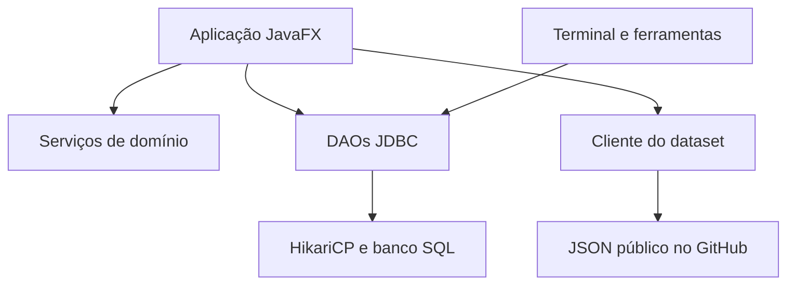

# Arquitetura observada

Base: auditoria de 19/10/2026 e complementos de 21/10/2026. Na revisão documental de 28/10/2026, foram reconferidos os pontos descritos de inicialização, serviços, montagem e salvamento contra os arquivos pertinentes do ZIP recebido. Esta descrição não comprova execução em produção nem registra justificativas históricas não fornecidas.

## Componentes e responsabilidades

| Área | Arquivos e responsabilidade |
| --- | --- |
| Inicialização gráfica | `DesktopLauncher` inicia `DesktopApp`; janela JavaFX com barra nativa, tema e validação inicial do banco |
| Sessão | `AutenticacaoView`, `AutenticacaoService`, `AutorizacaoService` e `UsuarioDAO` |
| Navegação | `AppShell`; telas de dashboard, builds, análises e jogos; opções administrativas condicionadas ao perfil |
| Interface | Classes `*View`, CSS em `resources`, utilitários e catálogo em `ui` |
| Montagem guiada | `BuildsView` gerencia lista e salvamento; `MontagemWizardView` apresenta uma categoria por vez; `service/MontagemPC` mantém o rascunho, etapas e regras de troca |
| Domínio | Entidades em `model`; compatibilidade, consumo, FPS e senhas em `service` |
| Persistência | Classes `*DAO`; conexão compartilhada via `ConnectionFactory` e HikariCP |
| Recomendações | `RecomendacaoJogoService` carrega catálogos/benchmarks por DAOs e monta recomendações |
| Integração externa | `PcPartDatasetClient` lê JSON público; `CatalogoImportacaoDAO` persiste importações em transação |
| Ferramentas administrativas | Validador de esquema, atualizador estrutural, diagnósticos e transferência entre bancos |
| Terminal legado | `Main`; entrada administrativa que exige login e perfil ADMIN, com cadastro pelo mesmo serviço gráfico |

## Fluxos e estados

Na abertura gráfica, `DatabaseSchemaValidator` verifica tabelas obrigatórias e algumas colunas. Sucesso leva à autenticação; falha mostra erro de inicialização. Depois do login, o objeto `Usuario` não mantém o hash da senha. O shell apresenta a navegação conforme o perfil e permite sair para a autenticação.

As telas usam DAOs diretamente em vários pontos. Serviços de cálculo recebem objetos de domínio; a separação existe, mas não forma uma camada única que imponha todas as regras de autorização e de negócio. Operações de builds específicas do usuário usam filtros SQL; as operações globais do terminal exigem administrador no acesso ao menu.

`UiSupport` oferece trabalho em threads virtuais e retorno via `Platform.runLater`; há estados de carregamento, erro, resultado vazio e sucesso. Isso descreve o mecanismo presente, sem garantir ausência de problemas de concorrência em todas as telas.

## Persistência e confiança

O processo desktop acessa o banco por JDBC. Não foi identificado backend HTTP próprio, API REST própria ou uso de Supabase Auth. O esquema e as fronteiras estão em [DATA_MODEL.md](DATA_MODEL.md) e [SECURITY.md](SECURITY.md). As credenciais de conta do aplicativo e as credenciais JDBC são diferentes.

## Integrações

O cliente do dataset usa `https://raw.githubusercontent.com/docyx/pc-part-dataset/main/data/json/`, com timeout de conexão de 12 s e de requisição de 40 s. Espera resposta HTTP 200 e array JSON. Há cache por categoria na instância do cliente e opção de atualizar. A integração contempla CPU, GPU, fonte, memória e SSD; não importa placa-mãe. Preço externo é referência em USD; a importação exige revisão e preço local em reais. Não há API key. A disponibilidade externa não foi validada nesta entrega.

Capas aceitam URLs HTTP/HTTPS; `ui/GameCatalog` tenta capas locais quando não há URL e mantém identificação textual se a imagem não estiver disponível. Fontes das artes: [FONTES.txt](../resources/images/games/FONTES.txt).

## Organização e limites

A estrutura acadêmica usa `src/`, `test/` e `resources/`, configurados no [pom.xml](../pom.xml), com várias classes no pacote padrão. O protótipo [figma-html](../figma-html/README.md) é visual, sem banco ou regras Java. Não há necessidade atual de OpenAPI ou de separar pastas de diagramas.

Acoplamento das telas, tamanho do terminal, duplicação de validações e scripts dependentes do ambiente constam em [TECH_DEBT.md](TECH_DEBT.md). Razões históricas da escolha de tecnologias requerem confirmação do mantenedor antes de produzir ADRs retroativos.

## Recursos adicionados em 21/10/2026

`ContaView` apresenta troca de senha e ferramentas administrativas de backup; `DatabaseBackupService` revalida perfil e senha no banco antes de exportar/restaurar. O arquivo JSON versionado contém apenas dados das 11 tabelas permitidas, sem SQL fornecido pelo arquivo. A restauração usa DELETE/INSERT em transação, sem TRUNCATE, com validação prévia e rollback em falhas.

`BuildDialogs` e `service/BuildExportService` apresentam comparação de builds próprias e exportações sem credenciais. `service/CatalogoFiltro` concentra busca textual normalizada/faixa de preço. `RecomendacaoJogoService` recebe orçamento, resolução e meta de FPS; os mesmos parâmetros alimentam a tela Jogos.

`DatabaseSecurityService` aplica RLS/revogações no atualizador PostgreSQL. Os DAOs de usuários, builds e importação aceitam fornecedor JDBC interno para testar com banco descartável, preservando o construtor padrão da aplicação. `DatabaseTransfer` compartilha a lista de tabelas/colunas com o backup para evitar omitir metadados novos dos jogos.

`MontagemPC` mantém uma cópia da build separada dos controles e oferece navegação, opções compatíveis e invalidação de seleções dependentes. `MontagemWizardView` renderiza busca, cards, resumo e revisão nos dois temas. `BuildsView` preserva o rascunho entre suas abas e delega a persistência aos DAOs existentes, em segundo plano e com ID do proprietário. O fluxo não acrescenta tabelas nem dependências.

## Fluxo da montagem e limites das camadas

1. `AppShell` usa `BuildsView.carregarDados()` em segundo plano e `UiSupport.carregarPagina()` para criar os controles na thread JavaFX a partir de `DadosIniciais`. `BuildsView` cria um `MontagemPC` independente para a nova montagem ou edição. O construtor público de conveniência continua síncrono e não é o caminho usado pela navegação normal.
2. `MontagemWizardView` encaminha seleção, avanço e retorno ao estado; as opções de placa-mãe, memória e fonte dependem das escolhas anteriores.
3. Na revisão, `MontagemPC.finalizar()` verifica completude, nome e compatibilidade e devolve a build a persistir. Trocar de etapa não grava dados.
4. `BuildsView.salvar()` desabilita as abas e chama `BuildsOperacoes` por `UiSupport.emSegundoPlano`. A operação verifica propriedade, grava por DAO e distingue gravação confirmada de falha posterior na consulta da lista. O callback descarta o rascunho salvo; com lista indisponível, limpa a tabela e orienta Atualizar lista. Falha de gravação continua como erro e mantém o rascunho. A atualização usa ID e proprietário.
5. Exclusão e atualização manual da lista também bloqueiam temporariamente as abas, serializando as operações desta tela. Exclusão confirmada com falha de consulta tem aviso próprio e remove o rascunho da build excluída.

A separação dados/controles foi implementada em 28/10/2026 para Minhas builds. As demais fábricas de páginas de `AppShell` ainda seguem o carregamento legado; esta mudança não afirma resolver toda a concorrência da aplicação. `UiSupport.moeda()` usa um formatador por thread, evitando compartilhar o estado mutável de `NumberFormat`; os tipos monetários do modelo permanecem iguais.

O projeto é desktop, com conexão JDBC direta; não há contrato de API HTTP próprio a documentar nesta estrutura. ADRs só devem registrar decisões confirmadas. **PENDENTE DE VALIDAÇÃO:** motivos históricos da escolha da arquitetura e eventual arquitetura para distribuição a clientes não confiáveis; veja [TECH_DEBT.md](TECH_DEBT.md).
